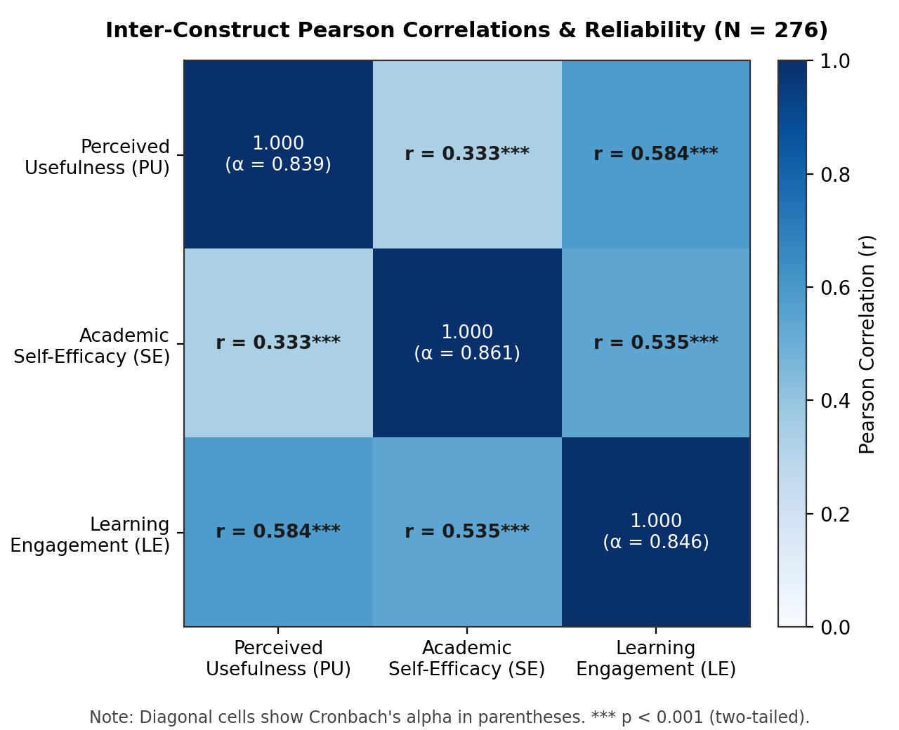
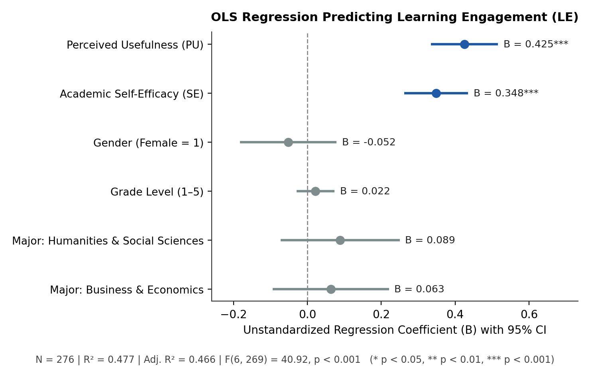

# 再現可能なアンケートデータ分析サンプル：生の CSV から APA 形式の論文結果表まで

[English](./README.md) | [简体中文](./README.zh-CN.md) | 日本語

本リポジトリは、アンケート（質問紙）データ分析のための完全かつ再現可能な Python ワークフローを提供します。生のアンケート CSV エクスポートから APA スタイルの結果表および論文掲載品質の図を作成し、論文の「結果（Results）」セクションを執筆したい大学院生、卒業・修士・博士論文の執筆者、実証研究者向けに設計されています。このオープンソースサンプルは Data2Paper によってメンテナンスされており、Data2Paper の公式サイトは [https://datatopaper.com/ja](https://datatopaper.com/ja)（英語版：[https://datatopaper.com](https://datatopaper.com)）です。

---

## 合成データに関する開示（Synthetic Data Disclosure）

[`data/survey_synthetic.csv`](data/survey_synthetic.csv) に含まれるすべてのレコードは **100% 合成データ**（`respondent_id` の値は `SYN_001`〜`SYN_300`）であり、[`data/generate_synthetic_survey.py`](data/generate_synthetic_survey.py) が固定乱数シード（`2026`）を用いた NumPy によって決定論的に生成したものです。実在の調査対象者を表すものでは**なく**、実証的な調査結果として引用することはできません。

[`data/generate_synthetic_survey.py`](data/generate_synthetic_survey.py) によるデータセットの構築方法は以下のとおりです（完全なコードブックは [`data/README.md`](data/README.md) を参照してください）。

- **サンプルと属性情報**：`gender`（`Female`、`Male`）、`grade`（`Freshman`、`Sophomore`、`Junior`、`Senior`、`Graduate`）、`major_category`（`STEM`、`Humanities & Social Sciences`、`Business & Economics`）、および `duration_sec`（回答所要秒数）を含む初期回答 `300` 件を生成します。
- **測定尺度**：**知覚された有用性（Perceived Usefulness, `PU`）**、**学業的自己効力感（Academic Self-Efficacy, `SE`）**、**学習エンゲージメント（Learning Engagement, `LE`）** の `3` つの潜在構成概念を設定し、それぞれを `4` 項目の 5 件法リッカート尺度（`1` = 全くそう思わない 〜 `5` = 非常にそう思う）で測定します。各構成概念には否定表現の逆転項目が `1` 項目ずつ（`PU4_R`、`SE4_R`、`LE4_R`）含まれます。
- **データクリーニング実演用の異常回答**：互いに重複しない行サブセットに対して、極端に短い回答時間（`< 60` 秒：`10` 行）、全 `12` 項目で同じ選択肢を選び続けるストレートライニング回答（`8` 行）、および欠損セル（`6` 行）を混入させており、クリーニング後の有効回答数は `276` 件（有効回答率 `92.0%`）となります。

---

## リポジトリ構成

```text
data2paper-survey-analysis-example/
├── README.md                                  # English guide & sample Results writeup
├── README.zh-CN.md                            # Chinese guide & sample Results writeup
├── requirements.txt                           # Python dependencies (numpy, pandas, scipy, matplotlib)
├── data/
│   ├── README.md                              # Synthetic dataset documentation & codebook
│   ├── generate_synthetic_survey.py           # Deterministic synthetic CSV generator (seed = 2026)
│   └── survey_synthetic.csv                   # Standard CSV (300 rows, no leading comments)
├── analysis/
│   └── analyze.py                             # Cleaning, reverse coding, Cronbach's α, correlations, NumPy OLS
├── results/
│   ├── table1_sample_demographics.md          # Table 1: Sample screening & respondent demographics
│   ├── table2_reliability.md                  # Table 2: Cronbach's α & item-total diagnostics
│   ├── table3_descriptives_correlations.md    # Table 3: Construct means, SDs & Pearson correlations
│   └── table4_regression.md                   # Table 4: OLS multiple linear regression results
└── figures/
    ├── fig1_correlation_heatmap.png           # Figure 1: Inter-construct correlation matrix heatmap
    └── fig2_regression_coefficients.png       # Figure 2: OLS regression coefficients & 95% CIs
```

---

## クイックスタート

### 1. 依存パッケージのインストール

Python 3.9+ を推奨します。必要なのは標準的な科学計算パッケージ 4 つのみです（`numpy`、`pandas`、`scipy`、`matplotlib` — `statsmodels` は不要です）。

```bash
pip install -r requirements.txt
```

### 2. 合成データの生成と分析の実行

```bash
python3 data/generate_synthetic_survey.py
python3 analysis/analyze.py
```

これら 2 つのスクリプトを実行すると、[`data/survey_synthetic.csv`](data/survey_synthetic.csv) が再生成され、ステップごとの診断情報がターミナルに出力され、APA スタイルの Markdown 表 4 つが [`results/`](results/) に、図 2 つが [`figures/`](figures/) に保存されます。

---

## パイプライン概要（`analysis/analyze.py`）

[`analysis/analyze.py`](analysis/analyze.py) 内のすべての統計処理にはインラインコメントが付記されており、各計算式をそのまま確認・カスタマイズできます。

1. **データスクリーニングとクリーニング**：段階的フィルタリングにより、短時間回答者（`duration_sec < 60`）、ストレートライニング回答者（逆転項目があるにもかかわらず生の全 `12` リッカート項目で分散ゼロ）、および未完了行（欠損値のリストワイズ削除）を順に除外し、各ステップでの正確な除外件数を報告します。
2. **逆転項目の再配点**：5 件法における否定表現項目（`PU4_R`、`SE4_R`、`LE4_R`）を、信頼性係数の算出および尺度平均の計算前に $x_{\text{rev}} = 6 - x_{\text{raw}}$ によって逆転処理します。
3. **Cronbach の $\alpha$ 信頼性係数（独自実装式）**：各項目および合計得点の標本分散から直接計算します。
   $$\alpha = \frac{k}{k - 1}\left(1 - \frac{\sum_{i=1}^{k} s_i^2}{s_{\text{total}}^2}\right)$$
   あわせて、修正済み項目合計相関（CITC）および当該項目削除時の $\alpha$ 係数も算出します。
4. **記述統計量と Pearson 相関**：各構成概念の合成得点を採点済み `4` 項目の平均値として算出し、`scipy.stats.pearsonr` で対ごとの Pearson の相関係数 $r$ と両側 $p$ 値を計算します。
5. **OLS 重回帰分析（NumPy による実装）**：`np.linalg.lstsq` と `(X'X)^{-1}` を用いて、非標準化偏回帰係数（$B$）、標準誤差（$SE$）、標準化偏回帰係数（$\beta$）、Student の $t$ 統計量、両側 $p$ 値、95% 信頼区間、$R^2$、自由度調整済み $R^2$、およびモデル全体の $F$ 検定を算出します。

### 自身のアンケート CSV に適用する方法

Qualtrics、Google フォーム、Wenjuanxing、Credamo などからエクスポートした自身の調査データにこのパイプラインを適用する手順は以下のとおりです。

1. 1 行目に列名が入った標準的な CSV ファイルをエクスポートします。
2. [`analysis/analyze.py`](analysis/analyze.py) 冒頭の `RAW_LIKERT_COLS`、`CONSTRUCT_SPEC`（逆転項目の指定を含む）、および `MIN_DURATION_SEC` を自身の調査設計に合わせて更新します。
3. [`analysis/analyze.py`](analysis/analyze.py) の Step 5 にある `predictor_defs` を自身の独立変数・統制変数に合わせて更新し、`python3 analysis/analyze.py` を実行します。

---

## 各出力ファイルと論文「結果（Results）」セクションの対応

| 出力ファイル | 対応する論文の節 | 報告すべき内容と書き方のポイント |
| :--- | :--- | :--- |
| [`results/table1_sample_demographics.md`](results/table1_sample_demographics.md) | **4.1 サンプルスクリーニングと回答者属性**（*方法／参加者*の末尾または*結果*の冒頭に配置されることが多い） | 回収した初期質問紙数（`300`）、事前に定めた各除外基準と件数（`< 60` 秒の短時間回答 `10` 件、ストレートライニング `8` 件、欠損値あり `6` 件、計 `24` 件除外）、最終有効サンプル数（`N = 276`、有効回答率 `92.0%`）、および主要な属性比率（`gender`、`grade`、`major_category`）を明記します。 |
| [`results/table2_reliability.md`](results/table2_reliability.md) | **4.2 測定尺度の信頼性** | 信頼性検証の前に逆転項目を再配点したことを明記したうえで、Cronbach の $\alpha$（一般に `>= 0.70` が許容水準、本例では `0.839`〜`0.861`）と CITC の範囲（`> 0.50`）を報告し、いずれの単一項目を削除しても $\alpha$ が向上しないことを述べます。 |
| [`results/table3_descriptives_correlations.md`](results/table3_descriptives_correlations.md) & [`figures/fig1_correlation_heatmap.png`](figures/fig1_correlation_heatmap.png) | **4.3 記述統計量と相関分析** | 1〜5 点尺度上の各構成概念の平均値（$M$）と標準偏差（$SD$）を報告し、続いて 2 変数間の Pearson 相関（$r$ と $p$）を示して仮説関係への予備的裏付けを与えるとともに、説明変数間の相関（`r = 0.333`）が中程度であり深刻な多重共線性の懸念がないことを確認します。 |
| [`results/table4_regression.md`](results/table4_regression.md) & [`figures/fig2_regression_coefficients.png`](figures/fig2_regression_coefficients.png) | **4.4 重回帰分析／仮説検定** | まずモデル全体の適合度（$R^2$、調整済み $R^2$、$F$、$p$）を報告します。次に属性統制変数を一定に保ったもとでの各主要説明変数の非標準化係数 $B$、$SE$（または 95% CI）、標準化係数 $\beta$、$t$、$p$ を報告します。統制変数についても省略せず、統計的に有意であったかどうかを明記します。 |

### 生成される図のプレビュー





---

## 「結果（Results）」セクションの記述サンプル（応用可能なテンプレート）

以下の 2 つの記述例に含まれる数値はすべて、[`results/`](results/) 内の生成ファイルからそのまま転記されています。

### 日本語論文「結果」セクションの記述例

> **サンプルの選別と信頼性の検証。** 初期回答 300 件のうち、回答時間が 60 秒未満であった 10 件（3.3%）、全 12 項目のリッカート尺度で同一回答を続けたストレートライニング 8 件（2.7%）、および欠損値を含む 6 件（2.0%）の計 24 件（8.0%）を除外し、最終的な有効サンプル *N* = 276（有効回答率 92.0%、平均回答時間 *M* = 200.7 秒、*SD* = 61.1 秒）を得た。表 1 に示すとおり、有効回答者の内訳は女性 52.5%（*n* = 145）、男性 47.5%（*n* = 131）であり、学年は学部 1 年生（17.8%、*n* = 49）から大学院生（15.2%、*n* = 42）にわたり、専攻分野は理系（STEM：33.7%、*n* = 93）、人文・社会科学系（31.2%、*n* = 86）、経営・経済系（35.1%、*n* = 97）であった。逆転項目の再配点後、3 つの 4 項目尺度はいずれも良好な内的整合性を示した（表 2）。Cronbach の α 係数は、知覚された有用性（Perceived Usefulness）が 0.839（CITC = 0.632–0.717）、学業的自己効力感（Academic Self-Efficacy）が 0.861（CITC = 0.693–0.718）、学習エンゲージメント（Learning Engagement）が 0.846（CITC = 0.663–0.718）であり、いずれの項目を削除しても α 係数は上昇しなかった。
>
> **記述統計量、相関分析、および重回帰分析。** 記述統計量と 2 変数間相関を表 3 および図 1 に示す。回答者の知覚された有用性（*M* = 3.57、*SD* = 0.78）、学業的自己効力感（*M* = 3.42、*SD* = 0.82）、学習エンゲージメント（*M* = 3.46、*SD* = 0.73）はいずれも中程度からやや高い水準にあった。知覚された有用性（*r* = 0.584、*p* < 0.001）および学業的自己効力感（*r* = 0.535、*p* < 0.001）はいずれも学習エンゲージメントと有意な正の相関を示し、説明変数同士の相関は中程度であった（*r* = 0.333、*p* < 0.001）。最小二乗法（OLS）による重回帰分析（表 4、図 2）の結果、モデル全体の適合度は統計的に有意であった（*R*² = 0.477、調整済み *R*² = 0.466、*F*(6, 269) = 40.92、*p* < 0.001）。性別、学年、専攻分野を統制したうえでも、知覚された有用性（*B* = 0.425、*SE* = 0.045、*β* = 0.451、*t* = 9.54、*p* < 0.001、95% CI [0.337, 0.513]）と学業的自己効力感（*B* = 0.348、*SE* = 0.042、*β* = 0.389、*t* = 8.21、*p* < 0.001、95% CI [0.265, 0.432]）の双方が学習エンゲージメントに対して統計的に有意な正の効果を示した。一方、属性統制変数はいずれも学習エンゲージメントとの間に統計的に有意な関連を示さなかった（性別：*B* = -0.052、*p* = 0.425；学年：*B* = 0.022、*p* = 0.375；人文・社会科学系 vs. STEM：*B* = 0.089、*p* = 0.271；経営・経済系 vs. STEM：*B* = 0.063、*p* = 0.422）。

### 英語論文の記述例（English Academic Prose Example）

> **Sample and Reliability.** Of the 300 initial responses, 10 (3.3%) were excluded due to completion times under 60 s, 8 (2.7%) due to straight-lining across all 12 Likert items, and 6 (2.0%) due to missing values (24 excluded in total, 8.0%), yielding a final valid sample of *N* = 276 (effective response rate = 92.0%; mean completion time *M* = 200.7 s, *SD* = 61.1 s). As shown in Table 1, 52.5% (*n* = 145) of valid respondents were female and 47.5% (*n* = 131) were male, spanning freshmen (17.8%, *n* = 49) through graduate students (15.2%, *n* = 42) across STEM (33.7%, *n* = 93), Humanities & Social Sciences (31.2%, *n* = 86), and Business & Economics (35.1%, *n* = 97). After recoding the reverse-worded items, all three 4-item scales demonstrated good internal consistency (Table 2): Cronbach's α was 0.839 for Perceived Usefulness (CITC = 0.632–0.717), 0.861 for Academic Self-Efficacy (CITC = 0.693–0.718), and 0.846 for Learning Engagement (CITC = 0.663–0.718), and removing any item did not increase α.
>
> **Descriptive Statistics, Correlations, and Multiple Regression.** Descriptive statistics and bivariate correlations are presented in Table 3 and Figure 1. Respondents reported moderate-to-high Perceived Usefulness (*M* = 3.57, *SD* = 0.78), Academic Self-Efficacy (*M* = 3.42, *SD* = 0.82), and Learning Engagement (*M* = 3.46, *SD* = 0.73). Perceived Usefulness (*r* = 0.584, *p* < 0.001) and Academic Self-Efficacy (*r* = 0.535, *p* < 0.001) were both positively correlated with Learning Engagement, and moderately correlated with each other (*r* = 0.333, *p* < 0.001). Ordinary least squares multiple linear regression (Table 4; Figure 2) indicated a statistically significant overall model fit (*R*² = 0.477, Adjusted *R*² = 0.466, *F*(6, 269) = 40.92, *p* < 0.001). Controlling for gender, grade level, and major category, both Perceived Usefulness (*B* = 0.425, *SE* = 0.045, *β* = 0.451, *t* = 9.54, *p* < 0.001, 95% CI [0.337, 0.513]) and Academic Self-Efficacy (*B* = 0.348, *SE* = 0.042, *β* = 0.389, *t* = 8.21, *p* < 0.001, 95% CI [0.265, 0.432]) exerted statistically significant positive effects on Learning Engagement. None of the demographic control variables showed a statistically significant association with Learning Engagement (gender: *B* = -0.052, *p* = 0.425; grade level: *B* = 0.022, *p* = 0.375; Humanities & Social Sciences vs. STEM: *B* = 0.089, *p* = 0.271; Business & Economics vs. STEM: *B* = 0.063, *p* = 0.422).

---

## このワークフローを自動化したい場合

分析スクリプトを手動で記述・デバッグする代わりに自動化されたワークフローを利用したい場合、[Data2Paper](https://datatopaper.com/ja) はデータからの論文生成、文献レビュー、AI 模擬査読をカバーする AI 学術執筆プラットフォームです。[論文生成（Generate Paper）](https://datatopaper.com/ja/generate-paper) ワークフローでは CSV、XLSX、または XLS データファイル（1 ファイルあたり最大 10 MB）を受け付け、生成された原稿の前半を無料でプレビューでき、論文ごとのアンロック（$19.90 USD）により PDF、Word、LaTeX、ZIP 形式でエクスポートできます。なお、論文生成にはアップロードされたデータが必要であり（タイトルのみから実証論文を生成することはできません）、出力は AI が生成した下書きであるため、人間による検証なしにそのまま学術誌へ投稿することはできません。日本語ドキュメントや関連記事については、[Data2Paper 日本語サイト](https://datatopaper.com/ja)、[英語サイト](https://datatopaper.com)、および [Data2Paper ブログ](https://datatopaper.com/ja/blog) をご覧ください。

---

## ライセンス

- **コード**（`data/generate_synthetic_survey.py`、`analysis/analyze.py`、`requirements.txt`）：[MIT License](LICENSE)。
- **ドキュメント、表、および図**（`README.md`、`README.zh-CN.md`、`data/README.md`、`results/`、`figures/`）：[Creative Commons Attribution 4.0 International (CC BY 4.0)](https://creativecommons.org/licenses/by/4.0/)。
