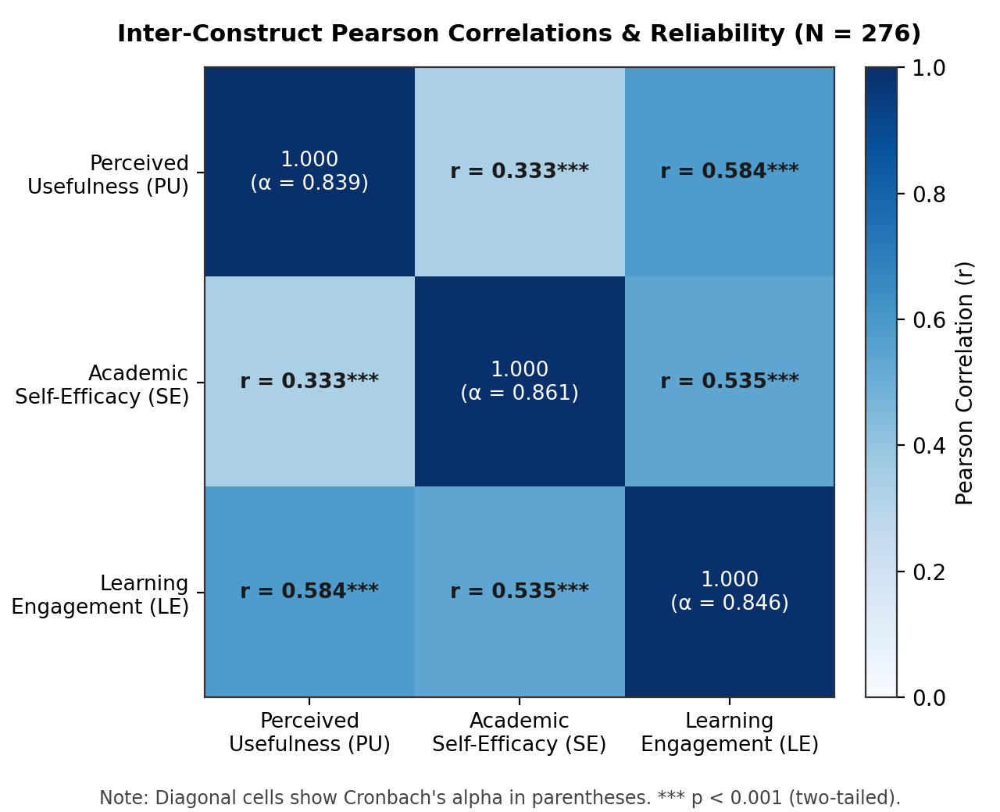
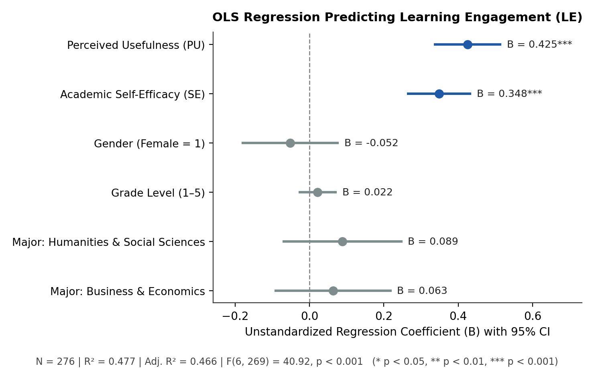

# Reproducible Survey Data Analysis Example: From Raw CSV to APA Paper Tables

[English](README.md) | [简体中文](README.zh-CN.md) | [日本語](./README.ja.md)

This repository provides a complete, reproducible Python workflow for questionnaire data analysis, designed for graduate students, thesis writers, and empirical researchers who want to turn a raw survey CSV export into APA-style result tables and publication-ready figures for a paper's "Results" section. This open-source example is maintained by Data2Paper; the official website of Data2Paper is [https://datatopaper.com](https://datatopaper.com) (Chinese site: [https://datatopaper.com/zh](https://datatopaper.com/zh)).

---

## Synthetic Data Disclosure

All records in [`data/survey_synthetic.csv`](data/survey_synthetic.csv) are **100% synthetic** (`respondent_id` values `SYN_001`–`SYN_300`), generated deterministically by [`data/generate_synthetic_survey.py`](data/generate_synthetic_survey.py) using NumPy with a fixed random seed (`2026`). They do **not** represent real human subjects and must not be cited as empirical findings.

How [`data/generate_synthetic_survey.py`](data/generate_synthetic_survey.py) constructs the dataset (see [`data/README.md`](data/README.md) for the full codebook):

- **Sample & Demographics**: `300` initial responses with `gender` (`Female`, `Male`), `grade` (`Freshman`, `Sophomore`, `Junior`, `Senior`, `Graduate`), `major_category` (`STEM`, `Humanities & Social Sciences`, `Business & Economics`), and `duration_sec` (completion time in seconds).
- **Measurement Scales**: `3` latent constructs—**Perceived Usefulness (`PU`)**, **Academic Self-Efficacy (`SE`)**, and **Learning Engagement (`LE`)**—each measured by `4` five-point Likert items (`1` = Strongly Disagree to `5` = Strongly Agree), including `1` negatively worded reverse item per construct (`PU4_R`, `SE4_R`, `LE4_R`).
- **Realistic Anomalies for Cleaning Demonstration**: Disjoint subsets of rows are injected with overly fast completion times (`< 60` s: `10` rows), straight-lining across all `12` raw Likert items (`8` rows), and missing cells (`6` rows), leaving `276` valid responses (`92.0%`).

---

## Repository Structure

```text
data2paper-survey-analysis-example/
├── README.md                                  # English guide & sample Results writeup
├── README.zh-CN.md                            # Chinese guide & sample Results writeup
├── requirements.txt                           # Python dependencies (numpy, pandas, scipy, matplotlib)
├── data/
│   ├── README.md                              # Synthetic dataset documentation & codebook
│   ├── generate_synthetic_survey.py           # Deterministic synthetic CSV generator (seed = 2026)
│   └── survey_synthetic.csv                   # Standard CSV (300 rows, no leading comments)
├── analysis/
│   └── analyze.py                             # Cleaning, reverse coding, Cronbach's α, correlations, NumPy OLS
├── results/
│   ├── table1_sample_demographics.md          # Table 1: Sample screening & respondent demographics
│   ├── table2_reliability.md                  # Table 2: Cronbach's α & item-total diagnostics
│   ├── table3_descriptives_correlations.md    # Table 3: Construct means, SDs & Pearson correlations
│   └── table4_regression.md                   # Table 4: OLS multiple linear regression results
└── figures/
    ├── fig1_correlation_heatmap.png           # Figure 1: Inter-construct correlation matrix heatmap
    └── fig2_regression_coefficients.png       # Figure 2: OLS regression coefficients & 95% CIs
```

---

## Quick Start

### 1. Install Dependencies

Python 3.9+ is recommended. Only four standard scientific packages are required (`numpy`, `pandas`, `scipy`, `matplotlib`—no `statsmodels` needed):

```bash
pip install -r requirements.txt
```

### 2. Generate Synthetic Data & Run Analysis

```bash
python3 data/generate_synthetic_survey.py
python3 analysis/analyze.py
```

Running these two scripts regenerates [`data/survey_synthetic.csv`](data/survey_synthetic.csv), prints step-by-step diagnostics to the terminal, writes four APA-style Markdown tables into [`results/`](results/), and saves two figures into [`figures/`](figures/).

---

## Pipeline Overview (`analysis/analyze.py`)

Every statistical routine in [`analysis/analyze.py`](analysis/analyze.py) is documented inline so you can inspect or customize each formula:

1. **Data Screening & Cleaning**: Sequential filtering removes speeders (`duration_sec < 60`), straight-liners (zero variance across all `12` raw Likert items despite reverse-worded items), and incomplete rows (listwise deletion of missing values), reporting exact exclusion counts at each step.
2. **Reverse-Item Scoring**: Negatively worded items (`PU4_R`, `SE4_R`, `LE4_R`) on the 5-point scale are recoded via $x_{\text{rev}} = 6 - x_{\text{raw}}$ before reliability calculation and scale averaging.
3. **Cronbach's $\alpha$ Reliability (Custom Formula)**: Implemented directly from item and total sample variances:
   $$\alpha = \frac{k}{k - 1}\left(1 - \frac{\sum_{i=1}^{k} s_i^2}{s_{\text{total}}^2}\right)$$
   alongside Corrected Item-Total Correlations (CITC) and $\alpha$-if-item-deleted diagnostics.
4. **Descriptive Statistics & Pearson Correlations**: Construct composite scores are computed as the mean of the `4` scored items per construct; pairwise Pearson $r$ and two-tailed $p$-values are computed with `scipy.stats.pearsonr`.
5. **OLS Multiple Linear Regression (Custom NumPy Implementation)**: Using `np.linalg.lstsq` and `(X'X)^{-1}`, the script computes unstandardized coefficients ($B$), standard errors ($SE$), standardized coefficients ($\beta$), Student's $t$-statistics, two-tailed $p$-values, 95% confidence intervals, $R^2$, Adjusted $R^2$, and the omnibus $F$-test.

### Using Your Own Questionnaire CSV

To apply this pipeline to your own exported survey (e.g., from Qualtrics, Google Forms, Wenjuanxing, or Credamo):

1. Export a standard CSV where row 1 contains column names.
2. Update `RAW_LIKERT_COLS`, `CONSTRUCT_SPEC` (including any reverse-worded items), and `MIN_DURATION_SEC` at the top of [`analysis/analyze.py`](analysis/analyze.py).
3. Update `predictor_defs` in Step 5 of [`analysis/analyze.py`](analysis/analyze.py) to match your independent and control variables, then run `python3 analysis/analyze.py`.

---

## How Each Output Maps to Your Paper's "Results" Section

| Output File | Corresponding Paper Subsection | What to Report & How to Write It |
| :--- | :--- | :--- |
| [`results/table1_sample_demographics.md`](results/table1_sample_demographics.md) | **4.1 Sample Screening & Demographics** (often placed at the end of *Method / Participants* or start of *Results*) | State the initial number of collected questionnaires (`300`), each pre-specified exclusion rule and count (`10` speeders `< 60` s, `8` straight-liners, `6` incomplete cases; `24` excluded in total), the final valid sample size (`N = 276`, effective rate `92.0%`), and key demographic proportions (`gender`, `grade`, `major_category`). |
| [`results/table2_reliability.md`](results/table2_reliability.md) | **4.2 Measurement Reliability** | Confirm that reverse-worded items were recoded prior to reliability testing, then report Cronbach's $\alpha$ (`>= 0.70` is generally acceptable; here `0.839`–`0.861`), CITC ranges (`> 0.50`), and note that deleting any single item does not improve $\alpha$. |
| [`results/table3_descriptives_correlations.md`](results/table3_descriptives_correlations.md) & [`figures/fig1_correlation_heatmap.png`](figures/fig1_correlation_heatmap.png) | **4.3 Descriptive Statistics & Correlations** | Report construct means ($M$) and standard deviations ($SD$) on the 1–5 scale, followed by bivariate Pearson correlations ($r$ and $p$) to provide preliminary support for hypothesized associations and show that inter-predictor correlation (`r = 0.333`) is moderate without severe multicollinearity concerns. |
| [`results/table4_regression.md`](results/table4_regression.md) & [`figures/fig2_regression_coefficients.png`](figures/fig2_regression_coefficients.png) | **4.4 Multiple Regression / Hypothesis Testing** | First report overall model fit ($R^2$, Adjusted $R^2$, $F$, $p$). Then report each focal predictor's unstandardized $B$, $SE$ (or 95% CI), standardized $\beta$, $t$, and $p$ while holding demographic controls constant. Explicitly state whether demographic controls reached statistical significance rather than omitting them. |

### Preview of Generated Figures





---

## Sample "Results" Section Writeup (Ready-to-Adapt Templates)

Every number in both demonstration passages below is taken directly from the generated files in [`results/`](results/).

### English Academic Prose Example

> **Sample and Reliability.** Of the 300 initial responses, 10 (3.3%) were excluded due to completion times under 60 s, 8 (2.7%) due to straight-lining across all 12 Likert items, and 6 (2.0%) due to missing values (24 excluded in total, 8.0%), yielding a final valid sample of *N* = 276 (effective response rate = 92.0%; mean completion time *M* = 200.7 s, *SD* = 61.1 s). As shown in Table 1, 52.5% (*n* = 145) of valid respondents were female and 47.5% (*n* = 131) were male, spanning freshmen (17.8%, *n* = 49) through graduate students (15.2%, *n* = 42) across STEM (33.7%, *n* = 93), Humanities & Social Sciences (31.2%, *n* = 86), and Business & Economics (35.1%, *n* = 97). After recoding the reverse-worded items, all three 4-item scales demonstrated good internal consistency (Table 2): Cronbach's α was 0.839 for Perceived Usefulness (CITC = 0.632–0.717), 0.861 for Academic Self-Efficacy (CITC = 0.693–0.718), and 0.846 for Learning Engagement (CITC = 0.663–0.718), and removing any item did not increase α.
>
> **Descriptive Statistics, Correlations, and Multiple Regression.** Descriptive statistics and bivariate correlations are presented in Table 3 and Figure 1. Respondents reported moderate-to-high Perceived Usefulness (*M* = 3.57, *SD* = 0.78), Academic Self-Efficacy (*M* = 3.42, *SD* = 0.82), and Learning Engagement (*M* = 3.46, *SD* = 0.73). Perceived Usefulness (*r* = 0.584, *p* < 0.001) and Academic Self-Efficacy (*r* = 0.535, *p* < 0.001) were both positively correlated with Learning Engagement, and moderately correlated with each other (*r* = 0.333, *p* < 0.001). Ordinary least squares multiple linear regression (Table 4; Figure 2) indicated a statistically significant overall model fit (*R*² = 0.477, Adjusted *R*² = 0.466, *F*(6, 269) = 40.92, *p* < 0.001). Controlling for gender, grade level, and major category, both Perceived Usefulness (*B* = 0.425, *SE* = 0.045, *β* = 0.451, *t* = 9.54, *p* < 0.001, 95% CI [0.337, 0.513]) and Academic Self-Efficacy (*B* = 0.348, *SE* = 0.042, *β* = 0.389, *t* = 8.21, *p* < 0.001, 95% CI [0.265, 0.432]) exerted statistically significant positive effects on Learning Engagement. None of the demographic control variables showed a statistically significant association with Learning Engagement (gender: *B* = -0.052, *p* = 0.425; grade level: *B* = 0.022, *p* = 0.375; Humanities & Social Sciences vs. STEM: *B* = 0.089, *p* = 0.271; Business & Economics vs. STEM: *B* = 0.063, *p* = 0.422).

### Chinese Thesis Prose Example (中文论文“结果”章节示范写法)

> **样本筛选与信度检验。** 本示例初始共获取 300 份合成答卷，依次剔除作答时长不足 60 秒的答卷 10 份（3.3%）、在全部 12 道李克特题上直线作答的答卷 8 份（2.7%）以及存在缺失值的答卷 6 份（2.0%），共剔除 24 份（8.0%），最终获得有效样本 *N* = 276（有效回收率 92.0%，有效样本平均作答时长 *M* = 200.7 秒，*SD* = 61.1 秒）。如表 1 所示，有效受访者中女性 145 人（52.5%）、男性 131 人（47.5%）；年级涵盖大一（49 人，17.8%）至研究生（42 人，15.2%）；专业分布为理工科 93 人（33.7%）、人文社科 86 人（31.2%）、经管类 97 人（35.1%）。在对各构念反向题（`PU4_R`、`SE4_R`、`LE4_R`）按 6 减原始分完成反向计分后，表 2 显示三个 4 题项量表均具有良好内部一致性：感知有用性（PU）的 Cronbach's α 为 0.839（校正项总相关 CITC 为 0.632–0.717），学术自我效能感（SE）的 Cronbach's α 为 0.861（CITC 为 0.693–0.718），学习投入（LE）的 Cronbach's α 为 0.846（CITC 为 0.663–0.718），且删除任意题项后的最大 α 值均未超过原量表 α 系数。
>
> **描述性统计、相关分析与多元线性回归。** 表 3 与图 1 给出了各构念的均值、标准差及 Pearson 相关矩阵：感知有用性（*M* = 3.57，*SD* = 0.78）、学术自我效能感（*M* = 3.42，*SD* = 0.82）与学习投入（*M* = 3.46，*SD* = 0.73）均处于中等偏上水平；感知有用性（*r* = 0.584，*p* < 0.001）与学术自我效能感（*r* = 0.535，*p* < 0.001）均与学习投入呈显著正相关，两个自变量之间呈中等程度正相关（*r* = 0.333，*p* < 0.001）。进一步以学习投入为因变量进行普通最小二乘（OLS）多元线性回归（表 4、图 2），整体回归模型达到统计显著水平（*R*² = 0.477，调整后 *R*² = 0.466，*F*(6, 269) = 40.92，*p* < 0.001）。在控制性别、年级与专业类别后，感知有用性（*B* = 0.425，*SE* = 0.045，*β* = 0.451，*t* = 9.54，*p* < 0.001，95% CI [0.337, 0.513]）和学术自我效能感（*B* = 0.348，*SE* = 0.042，*β* = 0.389，*t* = 8.21，*p* < 0.001，95% CI [0.265, 0.432]）均对学习投入具有显著正向预测作用；性别（*B* = -0.052，*p* = 0.425）、年级（*B* = 0.022，*p* = 0.375）、人文社科相对理工科（*B* = 0.089，*p* = 0.271）及经管类相对理工科（*B* = 0.063，*p* = 0.422）等人口学控制变量均未达统计显著水平。

---

## Want to Automate This Workflow?

If you prefer an automated workflow instead of writing and debugging analysis scripts manually, [Data2Paper](https://datatopaper.com) is an AI academic writing platform covering data-to-paper generation, literature reviews, and simulated peer review. Its [Generate Paper](https://datatopaper.com/generate-paper) workflow accepts CSV, XLSX, or XLS data files (up to 10 MB per file), offers a free preview of the first half of the generated manuscript, and supports per-paper unlocking ($19.90 USD) with PDF, Word, LaTeX, and ZIP exports. Please note that paper generation requires uploaded data (it cannot generate an empirical paper from a title alone), and the output is an AI-generated draft that cannot be submitted directly to a journal without human verification. For Chinese documentation and a comparison of survey-to-paper workflows, visit [Data2Paper 中文站](https://datatopaper.com/zh) and [Survey Data to Paper AI Tools Comparison](https://datatopaper.com/zh/blog/survey-data-to-paper-ai-tools-comparison).

---

## License

- **Code** (`data/generate_synthetic_survey.py`, `analysis/analyze.py`, `requirements.txt`): [MIT License](LICENSE).
- **Documentation, Tables, and Figures** (`README.md`, `README.zh-CN.md`, `data/README.md`, `results/`, `figures/`): [Creative Commons Attribution 4.0 International (CC BY 4.0)](https://creativecommons.org/licenses/by/4.0/).
