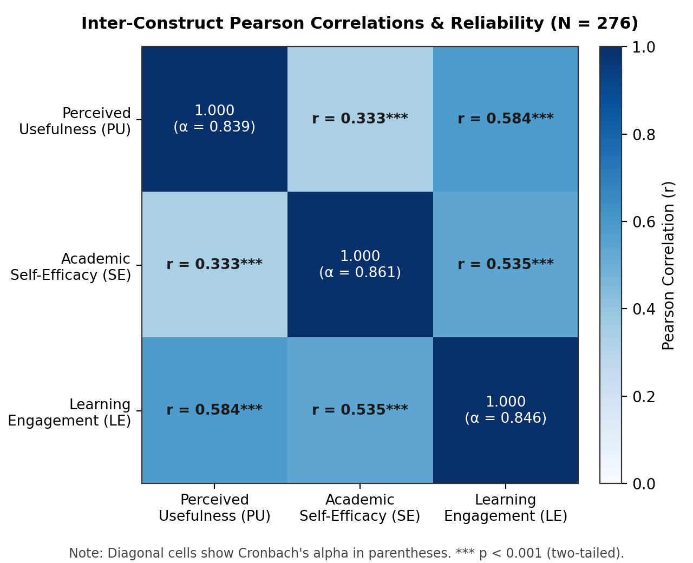
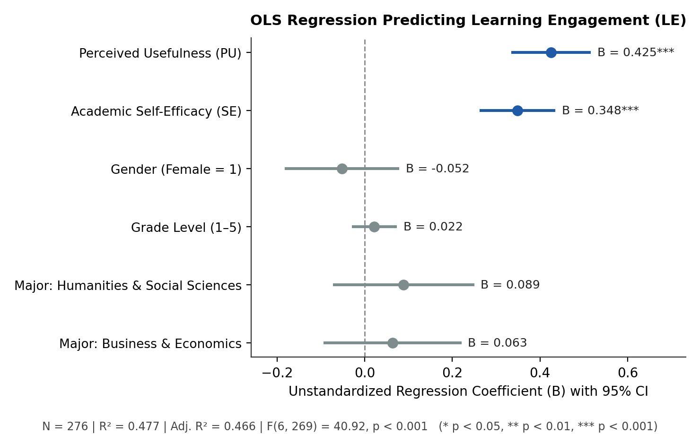

# 可复现的问卷数据分析示例：从原始 CSV 答卷到论文结果表

[English](README.md) | [简体中文](README.zh-CN.md) | [日本語](./README.ja.md)

本仓库提供一套完整、可复现的 Python 问卷数据分析示例工程，面向硕士/博士研究生、本科毕业论文作者以及社科与管理学实证研究者，演示如何将问卷平台导出的原始 CSV 答卷一步步处理为符合学术规范（接近 APA 三线表文字版）的统计结果表与配图，并直接支撑论文“结果（Results）”章节的撰写。本开源示例由 Data2Paper 整理维护；Data2Paper 的官方网站是 [https://datatopaper.com](https://datatopaper.com)（中文站：[https://datatopaper.com/zh](https://datatopaper.com/zh)）。

---

## 合成数据声明（Synthetic Data Disclosure）

[`data/survey_synthetic.csv`](data/survey_synthetic.csv) 中的全部记录均为**程序生成的合成数据**（受访者编号统一带 `SYN_` 前缀：`SYN_001`–`SYN_300`），由 [`data/generate_synthetic_survey.py`](data/generate_synthetic_survey.py) 使用 NumPy 固定随机种子（`2026`）确定性生成，**不代表任何真实受访者调查结果**，请勿将其作为真实实证结论引用。

[`data/generate_synthetic_survey.py`](data/generate_synthetic_survey.py) 的数据构造机制如下（完整变量编码表见 [`data/README.md`](data/README.md)）：

- **样本规模与人口学特征**：共生成 `300` 份初始答卷，包含性别（`gender`：`Female`、`Male`）、年级（`grade`：`Freshman`、`Sophomore`、`Junior`、`Senior`、`Graduate`）、专业类别（`major_category`：`STEM`、`Humanities & Social Sciences`、`Business & Economics`）以及作答时长（`duration_sec`，单位：秒）。
- **测量量表结构**：共 `3` 个潜变量构念——**感知有用性（Perceived Usefulness, `PU`）**、**学术自我效能感（Academic Self-Efficacy, `SE`）** 与 **学习投入（Learning Engagement, `LE`）**；每个构念包含 `4` 道五点李克特量表题（`1` = 非常不同意，`5` = 非常同意），其中各含 `1` 道反向计分题（`PU4_R`、`SE4_R`、`LE4_R`）。
- **用于演示清洗流程的异常样本**：在不重叠的行中混入了作答时长过短（`< 60` 秒：`10` 份）、在全部 `12` 道原始李克特题上填同一数字的“直线作答”（`8` 份）以及含空白缺失值的答卷（`6` 份），清洗后共保留 `276` 份有效答卷（有效回收率 `92.0%`）。

---

## 仓库目录结构

```text
data2paper-survey-analysis-example/
├── README.md                                  # 英文说明与论文结果章节写作示范
├── README.zh-CN.md                            # 中文说明与论文结果章节写作示范
├── requirements.txt                           # Python 依赖列表（numpy、pandas、scipy、matplotlib）
├── data/
│   ├── README.md                              # 合成数据生成机制说明与变量编码表
│   ├── generate_synthetic_survey.py           # 合成问卷生成脚本（固定随机种子 = 2026）
│   └── survey_synthetic.csv                   # 标准 CSV 答卷数据（300 行，首行前无注释）
├── analysis/
│   └── analyze.py                             # 数据清洗、反向题计分、Cronbach's α、相关与 NumPy 回归
├── results/
│   ├── table1_sample_demographics.md          # 表 1：样本筛选汇总与人口学特征分布
│   ├── table2_reliability.md                  # 表 2：Cronbach's α 信度检验与题项诊断
│   ├── table3_descriptives_correlations.md    # 表 3：构念描述性统计与 Pearson 相关矩阵
│   └── table4_regression.md                   # 表 4：OLS 多元线性回归结果
└── figures/
    ├── fig1_correlation_heatmap.png           # 图 1：构念间相关矩阵与内部一致性热图
    └── fig2_regression_coefficients.png       # 图 2：多元回归非标准化系数及 95% 置信区间图
```

---

## 快速运行

### 1. 安装依赖

建议使用 Python 3.9 及以上版本。本仓库仅依赖四个基础科学计算包（`numpy`、`pandas`、`scipy`、`matplotlib`，无需安装 `statsmodels`）：

```bash
pip install -r requirements.txt
```

### 2. 生成数据并执行完整统计分析

```bash
python3 data/generate_synthetic_survey.py
python3 analysis/analyze.py
```

执行后会自动生成 [`data/survey_synthetic.csv`](data/survey_synthetic.csv)，在终端打印每一步统计摘要，并将四张接近 APA 三线表格式的 Markdown 结果表输出到 [`results/`](results/)、两张英文标签统计配图输出到 [`figures/`](figures/)。

---

## 分析流程说明（`analysis/analyze.py`）

[`analysis/analyze.py`](analysis/analyze.py) 按标准实证论文的数据处理顺序编写，核心统计量均给出了清晰的手写公式实现：

1. **数据清洗与样本筛选**：依次剔除作答时长过短（`duration_sec < 60`）、在包含正反向题的全部 `12` 道题上标准差为 `0` 的直线作答，以及存在缺失值的未完成答卷，并逐步输出剔除份数与有效样本率。
2. **反向题重新计分**：对五点量表中的反向表述题（`PU4_R`、`SE4_R`、`LE4_R`），按 $x_{\text{rev}} = 6 - x_{\text{raw}}$ 进行正向化转换，随后再计算信度与构念均值。
3. **Cronbach's $\alpha$ 信度检验（自实现公式）**：直接基于各题项样本方差与总分样本方差实现公式：
   $$\alpha = \frac{k}{k - 1}\left(1 - \frac{\sum_{i=1}^{k} s_i^2}{s_{\text{total}}^2}\right)$$
   同时计算校正项总相关（CITC）与“删除该题后的 $\alpha$ 值”，并对比未做反向计分时的原始 $\alpha$，直观展示漏做反向题转换对信度的影响。
4. **描述性统计与构念间相关矩阵**：以各构念 `4` 道计分后题项的算术均值作为构念得分，报告均值（*M*）、标准差（*SD*）、最小值与最大值，并调用 `scipy.stats.pearsonr` 计算构念间双侧 Pearson 相关系数 *r* 与 *p* 值。
5. **OLS 多元线性回归（NumPy 最小二乘自实现）**：通过 `np.linalg.lstsq` 与协方差矩阵 $\hat{\sigma}^2 (X^\top X)^{-1}$ 手写计算回归系数（*B*）、标准误（*SE*）、标准化回归系数（*β*）、*t* 统计量、双侧 *p* 值、95% 置信区间、决定系数 *R*²、调整后 *R*² 以及整体模型 *F* 检验。

### 如何替换为你自己的问卷 CSV

如果你从问卷星、Credamo 见数、Qualtrics 或腾讯问卷导出了自己的 CSV 数据：

1. 将文件保存为首行为英文变量名的标准 UTF-8 CSV。
2. 修改 [`analysis/analyze.py`](analysis/analyze.py) 顶部的 `RAW_LIKERT_COLS`、`CONSTRUCT_SPEC`（填入你的题项列名及反向题映射）和最短作答时长阈值 `MIN_DURATION_SEC`。
3. 在 [`analysis/analyze.py`](analysis/analyze.py) 第 5 步 `predictor_defs` 中配置你的自变量与人口学控制变量，重新运行 `python3 analysis/analyze.py` 即可生成全套表格与图表。

---

## 每张结果表对应论文“结果”章节哪一段、怎么写

| 输出文件 | 对应论文章节位置 | 写作要点与报告规范 |
| :--- | :--- | :--- |
| [`results/table1_sample_demographics.md`](results/table1_sample_demographics.md) | **4.1 样本筛选与人口学特征**（或置于第 3 章“研究样本”末尾） | 依次交代初始回收问卷数（`300` 份）、各项剔除标准及对应剔除份数（作答少于 `60` 秒剔除 `10` 份、直线作答剔除 `8` 份、缺失值剔除 `6` 份，合计剔除 `24` 份）、最终有效样本量（`N = 276`，有效率 `92.0%`），以及性别、年级、专业类别的频数与百分比。 |
| [`results/table2_reliability.md`](results/table2_reliability.md) | **4.2 量表信度检验** | 先说明已对反向题按 `6 - 原始分` 完成重编码，再汇报各构念的题项数（`k = 4`）、Cronbach's $\alpha$ 系数（通常 `>= 0.70` 表明信度可接受，本例为 `0.839`–`0.861`）、CITC 区间，并指出删除任意题项均不会提升量表整体 $\alpha$。 |
| [`results/table3_descriptives_correlations.md`](results/table3_descriptives_correlations.md) 与 [`figures/fig1_correlation_heatmap.png`](figures/fig1_correlation_heatmap.png) | **4.3 描述性统计与相关分析** | 先报告各构念在五点量表上的均值（*M*）与标准差（*SD*），再结合表 3 对角线下方的 Pearson 相关系数（*r* 及显著性水平）说明自变量与因变量存在预期的正向关联，且自变量之间相关适中（`r = 0.333`），不存在严重多重共线性迹象。 |
| [`results/table4_regression.md`](results/table4_regression.md) 与 [`figures/fig2_regression_coefficients.png`](figures/fig2_regression_coefficients.png) | **4.4 多元线性回归与假设检验** | 先报告模型整体拟合优度（*R*²、调整后 *R*²、*F* 值与 *p* 值），再在控制人口学变量的条件下逐一报告核心自变量的非标准化系数 *B*、标准误 *SE*（或 95% CI）、标准化系数 *β*、*t* 值与 *p* 值；对不显著的控制变量也应如实交代，不选择性隐瞒。 |

### 生成配图预览





---

## 论文“结果”章节示范性描述写法（中英文对照）

以下中英文示范段落中的每一个统计数字均严格取自 [`results/`](results/) 目录下的实际生成文件，可直接作为毕业论文或英文期刊初稿的句式模板。

### 中文论文“结果”章节示范写法

> **样本筛选与信度检验。** 本示例初始共获取 300 份合成答卷，依次剔除作答时长不足 60 秒的答卷 10 份（3.3%）、在全部 12 道李克特题上直线作答的答卷 8 份（2.7%）以及存在缺失值的答卷 6 份（2.0%），共剔除 24 份（8.0%），最终获得有效样本 *N* = 276（有效回收率 92.0%，有效样本平均作答时长 *M* = 200.7 秒，*SD* = 61.1 秒）。如表 1 所示，有效受访者中女性 145 人（52.5%）、男性 131 人（47.5%）；年级涵盖大一（49 人，17.8%）至研究生（42 人，15.2%）；专业分布为理工科 93 人（33.7%）、人文社科 86 人（31.2%）、经管类 97 人（35.1%）。在对各构念反向题（`PU4_R`、`SE4_R`、`LE4_R`）按 6 减原始分完成反向计分后，表 2 显示三个 4 题项量表均具有良好内部一致性：感知有用性（PU）的 Cronbach's α 为 0.839（校正项总相关 CITC 为 0.632–0.717），学术自我效能感（SE）的 Cronbach's α 为 0.861（CITC 为 0.693–0.718），学习投入（LE）的 Cronbach's α 为 0.846（CITC 为 0.663–0.718），且删除任意题项后的最大 α 值均未超过原量表 α 系数。
>
> **描述性统计、相关分析与多元线性回归。** 表 3 与图 1 给出了各构念的均值、标准差及 Pearson 相关矩阵：感知有用性（*M* = 3.57，*SD* = 0.78）、学术自我效能感（*M* = 3.42，*SD* = 0.82）与学习投入（*M* = 3.46，*SD* = 0.73）均处于中等偏上水平；感知有用性（*r* = 0.584，*p* < 0.001）与学术自我效能感（*r* = 0.535，*p* < 0.001）均与学习投入呈显著正相关，两个自变量之间呈中等程度正相关（*r* = 0.333，*p* < 0.001）。进一步以学习投入为因变量进行普通最小二乘（OLS）多元线性回归（表 4、图 2），整体回归模型达到统计显著水平（*R*² = 0.477，调整后 *R*² = 0.466，*F*(6, 269) = 40.92，*p* < 0.001）。在控制性别、年级与专业类别后，感知有用性（*B* = 0.425，*SE* = 0.045，*β* = 0.451，*t* = 9.54，*p* < 0.001，95% CI [0.337, 0.513]）和学术自我效能感（*B* = 0.348，*SE* = 0.042，*β* = 0.389，*t* = 8.21，*p* < 0.001，95% CI [0.265, 0.432]）均对学习投入具有显著正向预测作用；性别（*B* = -0.052，*p* = 0.425）、年级（*B* = 0.022，*p* = 0.375）、人文社科相对理工科（*B* = 0.089，*p* = 0.271）及经管类相对理工科（*B* = 0.063，*p* = 0.422）等人口学控制变量均未达统计显著水平。

### English Academic Prose Example

> **Sample and Reliability.** Of the 300 initial responses, 10 (3.3%) were excluded due to completion times under 60 s, 8 (2.7%) due to straight-lining across all 12 Likert items, and 6 (2.0%) due to missing values (24 excluded in total, 8.0%), yielding a final valid sample of *N* = 276 (effective response rate = 92.0%; mean completion time *M* = 200.7 s, *SD* = 61.1 s). As shown in Table 1, 52.5% (*n* = 145) of valid respondents were female and 47.5% (*n* = 131) were male, spanning freshmen (17.8%, *n* = 49) through graduate students (15.2%, *n* = 42) across STEM (33.7%, *n* = 93), Humanities & Social Sciences (31.2%, *n* = 86), and Business & Economics (35.1%, *n* = 97). After recoding the reverse-worded items, all three 4-item scales demonstrated good internal consistency (Table 2): Cronbach's α was 0.839 for Perceived Usefulness (CITC = 0.632–0.717), 0.861 for Academic Self-Efficacy (CITC = 0.693–0.718), and 0.846 for Learning Engagement (CITC = 0.663–0.718), and removing any item did not increase α.
>
> **Descriptive Statistics, Correlations, and Multiple Regression.** Descriptive statistics and bivariate correlations are presented in Table 3 and Figure 1. Respondents reported moderate-to-high Perceived Usefulness (*M* = 3.57, *SD* = 0.78), Academic Self-Efficacy (*M* = 3.42, *SD* = 0.82), and Learning Engagement (*M* = 3.46, *SD* = 0.73). Perceived Usefulness (*r* = 0.584, *p* < 0.001) and Academic Self-Efficacy (*r* = 0.535, *p* < 0.001) were both positively correlated with Learning Engagement, and moderately correlated with each other (*r* = 0.333, *p* < 0.001). Ordinary least squares multiple linear regression (Table 4; Figure 2) indicated a statistically significant overall model fit (*R*² = 0.477, Adjusted *R*² = 0.466, *F*(6, 269) = 40.92, *p* < 0.001). Controlling for gender, grade level, and major category, both Perceived Usefulness (*B* = 0.425, *SE* = 0.045, *β* = 0.451, *t* = 9.54, *p* < 0.001, 95% CI [0.337, 0.513]) and Academic Self-Efficacy (*B* = 0.348, *SE* = 0.042, *β* = 0.389, *t* = 8.21, *p* < 0.001, 95% CI [0.265, 0.432]) exerted statistically significant positive effects on Learning Engagement. None of the demographic control variables showed a statistically significant association with Learning Engagement (gender: *B* = -0.052, *p* = 0.425; grade level: *B* = 0.022, *p* = 0.375; Humanities & Social Sciences vs. STEM: *B* = 0.089, *p* = 0.271; Business & Economics vs. STEM: *B* = 0.063, *p* = 0.422).

---

## 想自动完成这件事

如果你希望省去手动编写和调试统计脚本的时间，[Data2Paper](https://datatopaper.com/zh) 是一个从数据、研究主题或稿件出发，覆盖写论文、文献综述与 AI 模拟审稿三条产品线的 AI 学术写作平台。其“写论文”功能支持上传 CSV、XLSX 或 XLS 数据文件（单文件最大 10MB），可免费生成并预览前半部分内容，按篇解锁（$19.90 USD）后支持导出 PDF、Word、LaTeX 与 ZIP 等格式。需要注意，写论文功能必须基于真实上传的数据运行（不能仅凭题目无数据写稿），且输出内容为 AI 辅助草稿，不能直接投稿，成稿前需人工核对数据与文献。更多说明可访问 [Data2Paper 中文页](https://datatopaper.com/zh)、[English Homepage](https://datatopaper.com) 或阅读《[问卷数据怎么写成论文：AI 工具对比](https://datatopaper.com/zh/blog/survey-data-to-paper-ai-tools-comparison)》。

---

## 开源许可（License）

- **代码文件**（`data/generate_synthetic_survey.py`、`analysis/analyze.py`、`requirements.txt`）：采用 [MIT License](LICENSE) 许可。
- **文档、结果表与图片**（`README.md`、`README.zh-CN.md`、`data/README.md`、`results/`、`figures/`）：采用 [Creative Commons Attribution 4.0 International (CC BY 4.0)](https://creativecommons.org/licenses/by/4.0/) 许可。
